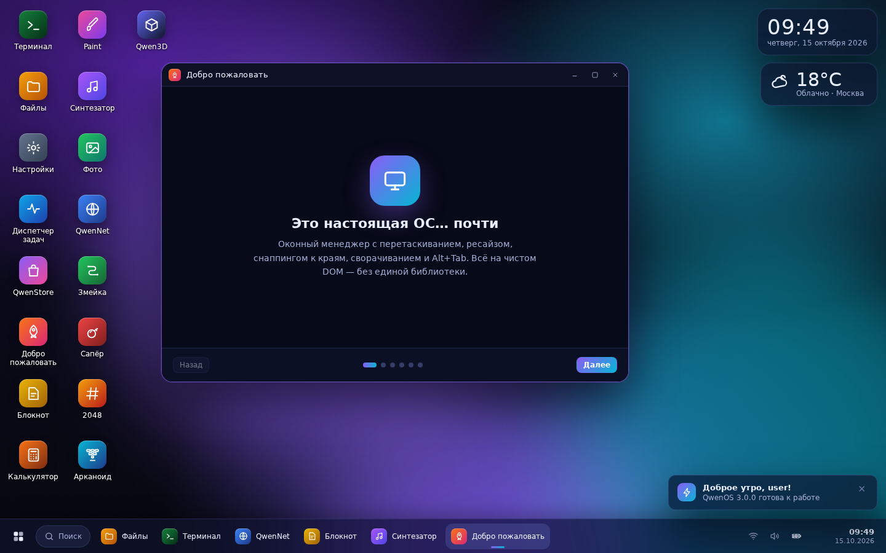
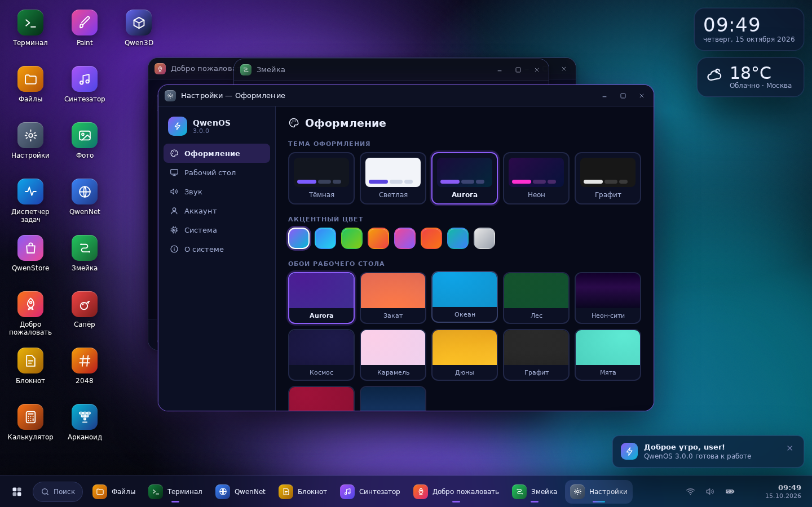
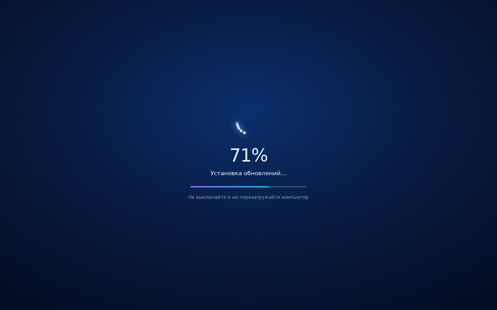

# QwenOS 3.0 «Aurora»

**Операционная система, которая живёт во вкладке браузера.**
Оконный менеджер, терминал с 40+ командами, виртуальная файловая система, магазин приложений,
игры и процедурный синтезатор музыки — всё на чистом HTML/CSS/JavaScript, **без единой внешней
зависимости, без сборки и без сервера**.

🌐 **Живая версия:** <https://yungspiderq.github.io/QwenOS/>



---

## Что внутри

| Подсистема | Возможности |
|---|---|
| **Загрузка** | BIOS-лог, прогресс-бар, экран блокировки с паролем, приветствие первого запуска |
| **Оконный менеджер** | перетаскивание, ресайз за 8 граней, снаппинг к краям (½ экрана и maximize), сворачивание, Alt+Tab, обзор окон с живыми миниатюрами (Win+Tab) |
| **Рабочий стол** | 12 обоев с анимированными эффектами (световые пятна, звёзды, сетка), виджеты часов/погоды/системы, рамка выделения иконок, контекстное меню |
| **Терминал `qsh`** | `ls cd cat tree grep find mkdir rm mv cp wc du echo > neofetch ps kill free df history calc matrix cowsay say ping curl sudo …`, автодополнение по Tab, история ↑/↓, перенаправление вывода в файл |
| **Файловая система** | полноценное дерево `/home`, `/etc`, `/var/log`, `/proc`; сохраняется в localStorage между сеансами; проводник с сеткой/списком, поиском и контекстным меню |
| **Приложения (20)** | Файлы, Терминал, Блокнот (Markdown), Калькулятор, Настройки, Диспетчер задач, QwenStore, Paint, Синтезатор, Фото, QwenNet (браузер), Змейка, Сапёр, 2048, Арканоид, Qwen3D (рейкастинг), Погода*, Таймер*, Матрица* |
| **Оформление** | 5 тем (тёмная, светлая, Aurora, неон, графит), 8 акцентов, масштаб интерфейса, отключение анимаций |
| **Звук** | WebAudio-синтезатор: 4 процедурных трека с басом, арпеджио и ударными + живой спектро-визуализатор; системные звуки интерфейса |
| **PWA** | манифест, service worker (network-first, полный офлайн), установка как приложение, иконки и ярлыки |
| **Центр обновлений** | автопроверка `version.json` каждые 5 минут, уведомление «Доступны обновления», экран установки в стиле Windows (крутящиеся точки, %, «не выключайте компьютер»), перезапуск и карточка «что нового» |
| **Мобильные** | окна на весь экран, свайпы в играх, компактная панель задач |

\* устанавливаются из QwenStore.





## Горячие клавиши

| Клавиши | Действие |
|---|---|
| `Ctrl+Alt+T` / `Ctrl+Alt+F` | Терминал / Файлы |
| `Meta` или `Ctrl+Esc` | Меню «Пуск» |
| `Alt+Tab` / `Shift+Alt+Tab` | Переключение окон |
| `Meta+Tab` | Обзор всех окон |
| `Ctrl+Alt+L` | Заблокировать экран |
| `Ctrl+Alt+M` | Диспетчер задач |
| `Esc` | Закрыть меню / обзор |
| `Ctrl+S` | Сохранить (Блокнот, Paint) |
| `F2` / `Del` | Переименовать / удалить выбранное на столе |

## Как запустить

Вариант 1 — просто открыть файл:

```bash
git clone https://github.com/yungspiderq/QwenOS
cd QwenOS
# откройте index.html в браузере (двойной клик) — система запустится
```

Вариант 2 — локальный сервер (для service worker и PWA):

```bash
cd QwenOS/docs
python3 -m http.server 8000
# → http://localhost:8000
```

Вариант 3 — GitHub Pages: репозиторий уже опубликован, источник — ветка `main`, папка `docs/`.

> Данные (файлы, настройки, рекорды игр) хранятся в `localStorage` браузера и переживают
> перезагрузку страницы. Кнопка «Форматировать» в Настройки → Система стирает всё.

## Структура проекта

```
├── index.html              ← редирект на docs/ (удобно при локальном открытии)
├── docs/                   ← сама ОС (источник GitHub Pages)
│   ├── index.html          ← оболочка: boot, lock, рабочий стол, панель задач
│   ├── manifest.webmanifest, sw.js, favicon.svg, assets/
│   ├── css/  base · desktop · windows · apps
│   └── js/
│       ├── core.js         ← утилиты, шина, настройки, иконки, реестр приложений, SFX
│       ├── fs.js           ← виртуальная ФС с персистентностью
│       ├── wm.js           ← оконный менеджер
│       ├── desktop.js      ← обои, иконки, виджеты, контекстные меню, обзор
│       ├── taskbar.js      ← панель задач, «Пуск», трей, быстрые настройки
│       ├── boot.js         ← загрузка, вход, питание, горячие клавиши, PWA
│       └── apps/           ← system · system-ui · productivity · media · games
└── tests/                  ← автотесты (jsdom + Playwright)
```

## Архитектура

- **Никакого eval для пользовательского ввода**: калькулятор использует собственный
  рекурсивно-спусковой парсер выражений; терминал разбирает команды токенами.
- **Приложение = объект** с `mount(win, api)`, возвращающим функцию очистки: реестр
  `OS.Apps.register({...})` сам рисует иконки, пункты «Пуска», задачи и карточки магазина.
- **Шина событий** `OS.bus` связывает подсистемы без прямых зависимостей
  (`wm:open`, `fs:changed`, `settings`, `apps:changed` …).
- **Окно** — обычный DOM-узел с pointer-events; композитор = z-index + CSS-анимации.
- Рендер 3D в Qwen3D — классический рейкастинг (DDA) на canvas, ~200 строк.

## Тесты

```bash
# 1) смоук-тест ядра и всех приложений (jsdom, без браузера)
npm i --prefix tests jsdom
node tests/smoke.js

# 2) интеракционный тест в реальном Chromium: drag/resize, меню, клавиатура, игры
pip install playwright && playwright install chromium
python3 tests/inter.py
```

Смоук-тест проверяет загрузку, вход, монтирование всех 20 приложений, команды терминала,
ФС, парсер калькулятора и оконный менеджер. Интеракционный — 23 сценария с настоящей мышью
и клавиатурой (перетаскивание, ресайз, снаппинг, контекстные меню, установка из магазина,
рисование в Paint, блокировка экрана).

## Лицензия

MIT — используйте, изменяйте и распространяйте свободно.

---

Сделано с любовью к веб-платформе. Если система запустилась — значит, браузер и есть компьютер. 🖥️
